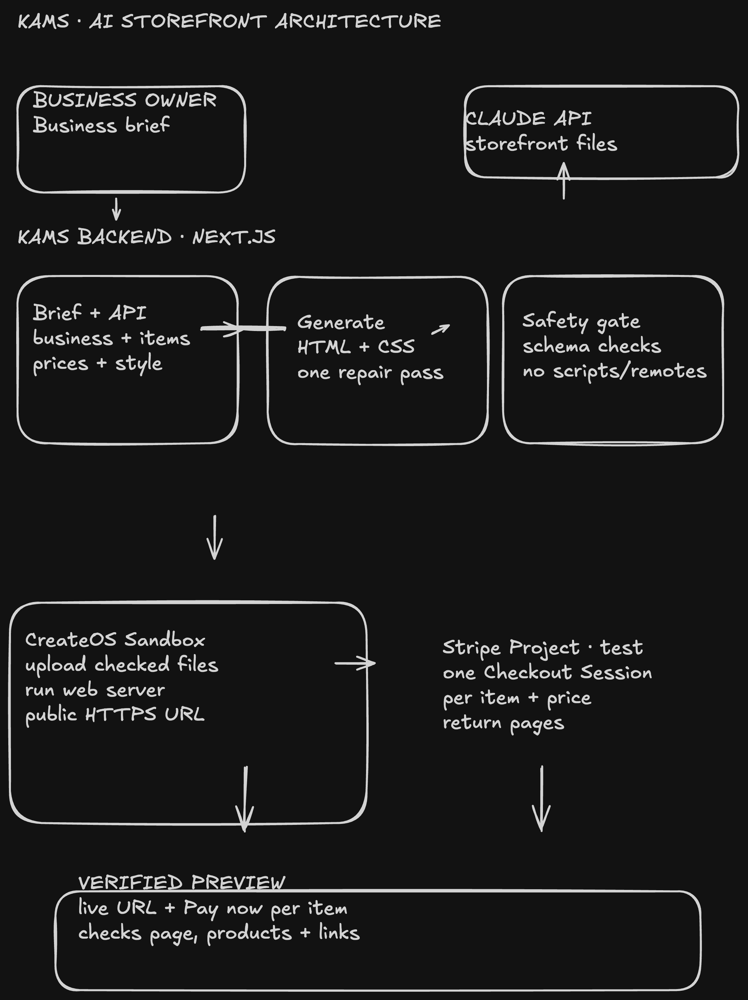

# Kams — From Business Brief to Live Storefront

> Kams turns a small business owner's description into a custom storefront, runs the generated page in a CreateOS Sandbox, checks the live preview, and adds a Stripe test-mode Pay now button to each priced product or service.

Built for the CreateOS × Stripe Projects Hackathon.

* * *
## Live

  * 🎥 Demo video — https://youtu.be/xK3cGcaKdYI
  * 📖 Setup guide — [`setup.md`](setup.md)
  * Live demo - https://kams-roan.vercel.app
  * 🗺️ Architecture — see [Architecture](#architecture) below

* * *
## Table of Contents

  * [Quick Path](#quick-path)
  * [Why It Stands Out](#why-it-stands-out)
  * [What it does](#what-it-does)
  * [Architecture](#architecture)
  * [Requirements](#requirements)
  * [Setup](#setup)
  * [Usage](#usage)
  * [Kams at the storefront boundary](#kams-at-the-storefront-boundary)
    * [From a brief to storefront code](#from-a-brief-to-storefront-code)
    * [CreateOS Sandbox preview](#createos-sandbox-preview)
    * [One Stripe Checkout per item](#one-stripe-checkout-per-item)
    * [Validation and safety boundaries](#validation-and-safety-boundaries)
  * [Project layout](#project-layout)
  * [AI assistance](#ai-assistance)
  * [License](#license)

* * *
## Quick Path

If you want the shortest path through the project:

```bash
npm ci
cp .env.example .env   # configure the server-side keys described in Setup
npm run dev
```

Then open `http://localhost:3000`, choose a demo preset, and click **Generate Storefront Preview**. Kams returns a public CreateOS Sandbox preview after it checks the page and each Stripe Checkout link.

For provider setup and integration details, read [`setup.md`](setup.md).

## Why It Stands Out

Kams demonstrates an end-to-end workflow for a real business need:

  * It takes a practical input from a small business owner: the brand, its products or services, individual prices, and a visual direction.
  * It turns that brief into a tailored storefront and runs the generated code in a real CreateOS Sandbox, so the result is a live preview rather than a code-only response.
  * It puts a separate **Pay now** action on every item card. Each action opens a Stripe test-mode Checkout Session created for that item's price.
  * It checks the served page and each payment link before returning the preview to the owner.

The demo connects AI code generation, sandbox execution, verification, and payments in one repeatable loop.

## What it does

  * Business brief — collect the business name and category, up to six products or services with separate prices, a description, and a design direction.
  * Storefront generation — ask Claude to produce static `index.html` and `styles.css` files using a constrained tool schema.
  * Safe execution — validate the generated files, upload them to CreateOS Sandbox, and start a static web server there.
  * Item-level payments — create one Stripe test Checkout Session for each item, then place its **Pay now** button and price inside that item's card.
  * Preview verification — check the public page, business details, all item cards and payment links, and the success and cancellation return pages.
  * Clear outcome — show a verified preview URL and the checks that passed.

## Architecture



The browser sends the brief to the Next.js server route, which streams progress while Kams generates and validates static files, runs them in CreateOS Sandbox, creates Stripe test Checkout Sessions, and checks the public preview.

```text
Business owner
  → Kams brief form
  → Claude generates constrained HTML/CSS
  → Kams validates files and product insertion point
  → CreateOS Sandbox runs the static storefront
  → Stripe test Checkout Session for each item
  → Kams inserts per-card Pay now buttons and verifies the public page
  → Shareable Sandbox preview URL
```

Stripe, Anthropic, and CreateOS credentials stay on the Kams server. The Sandbox receives the storefront files, not provider API keys.

## Requirements

  * Node.js 20.9+ and npm
  * Git
  * An Anthropic API key for Claude generation
  * A CreateOS Sandbox API key, supplied through the Kams Stripe Project environment
  * A Stripe **test-mode** secret key beginning with `sk_test_`
  * Stripe CLI with its Projects plugin for project and service setup

## Setup

### 1. Install dependencies

From the repository root:

```bash
npm ci
```

### 2. Configure the environment

Create the ignored local environment file:

```bash
cp .env.example .env
```

Set the values locally. Do not put secrets in chat, source files, or browser environment variables.

```dotenv
ANTHROPIC_API_KEY=your_anthropic_key
ANTHROPIC_MODEL=claude-sonnet-5
CREATEOS_API_KEY=your_createos_sandbox_key
STRIPE_SECRET_KEY=sk_test_your_stripe_test_key
```

For the provisioned hackathon project, use Stripe Projects to connect CreateOS and synchronize its server-side credential. The app also accepts `CREATEOS_SANDBOX_API_KEY` if that is the name provided by your environment. See [`setup.md`](setup.md) for platform-specific provider setup and checks.

Kams rejects a Stripe live secret key. Keep the payment integration in test mode.

### 3. Start Kams

```bash
npm run dev
```

Open `http://localhost:3000`. The `/api/build` route streams progress while the server prepares the preview.

### 4. Test a product payment

Choose a preset or enter one or more products/services with their own prices, then build the storefront. Open the returned preview and select **Pay now** on an item card. Use Stripe's test card `4242 4242 4242 4242`, any future expiration date, and any CVC. No real payment is taken.

## Usage

1. Enter the business name and business category.
2. Add one to six products or services. Each item needs a name and USD price; its short description is optional.
3. Add a business description and visual direction.
4. Select **Generate Storefront Preview** and follow the build progress.
5. Open the returned Sandbox URL. Each product/service card has its own price, **Pay now** button, and Stripe test-mode label.
6. Complete or cancel a Checkout Session with Stripe test data to see the preview's return page.

Each generated Checkout Session is temporary and expires. Build a fresh preview to create new payment links. This MVP does not save storefronts, process fulfillment, or verify payment webhooks.

## Kams at the storefront boundary

Kams connects a business brief to a preview that can be inspected and tested:

```text
Business owner
  → Kams form and server-side build route
  → Claude-generated static storefront files
  → CreateOS Sandbox and public preview
  → Stripe test Checkout links on each item card
```

The backend keeps the provider credentials and inserts the hosted Checkout URLs only after it validates Claude's output. The Sandbox runs a static web server and receives no Anthropic or Stripe secret keys.

### From a brief to storefront code

The owner supplies business details and priced items. Claude returns only `index.html`, `styles.css`, and a short summary using a fixed tool schema. Kams checks file shape, size, remote content, unsafe markup, and the exact product-card insertion point. It can ask Claude for one corrected draft when validation fails.

### CreateOS Sandbox preview

Kams creates a fresh Sandbox with ingress disabled, uploads the validated files, starts a static server, waits for its port, and then enables ingress. It checks the public URL before returning it. Generated storefront code runs in the Sandbox, not in the app server process.

### One Stripe Checkout per item

Kams creates one Stripe test-mode Checkout Session for each submitted product or service using that item's name, optional description, and price. It inserts the hosted URL into a **Pay now** button within the matching product card. Prices are one-time USD payments; all test cards and sessions are for demonstration only.

### Validation and safety boundaries

  * The API accepts one to six items and validates each name and USD price on the server.
  * Generated content is limited to static HTML and CSS; active scripts, forms, embedded content, and remote assets are rejected.
  * Claude does not choose or fabricate Checkout URLs. Kams creates and inserts them after validating the generated files.
  * Provider credentials stay server-side and are never uploaded to the Sandbox.
  * A failed build expires any Checkout Sessions already created and destroys its temporary Sandbox.
  * This is a test Checkout demonstration. It does not fulfill orders or process webhooks.

## Project layout

```text
app/
  api/build/route.ts       # brief validation and streamed build route
  page.tsx                 # Kams brief, progress, and preview interface
components/
  StorefrontForm.tsx       # business and per-item pricing form
  ExecutionPipeline.tsx    # live build stages
  BrowserPreview.tsx       # verified preview and result checks
lib/
  storefront.ts            # Claude, validation, CreateOS, and Stripe flow
types/
  index.ts                 # form and build event types
docs/
  kams-architecture.png    # architecture diagram
setup.md                   # provider and local setup details
```

## AI assistance

Claude is called at runtime to generate the storefront files from each business brief. Codex assisted with implementation, code review, validation, and this documentation update.

## License

No license has been selected and this repository has no `LICENSE` file. Permission to reuse the code has not been specified.
